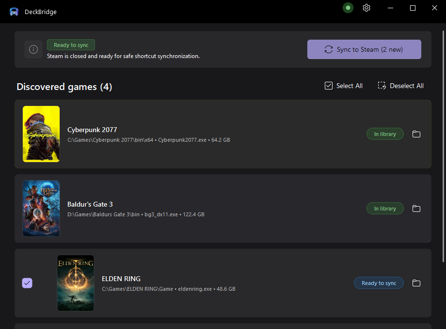
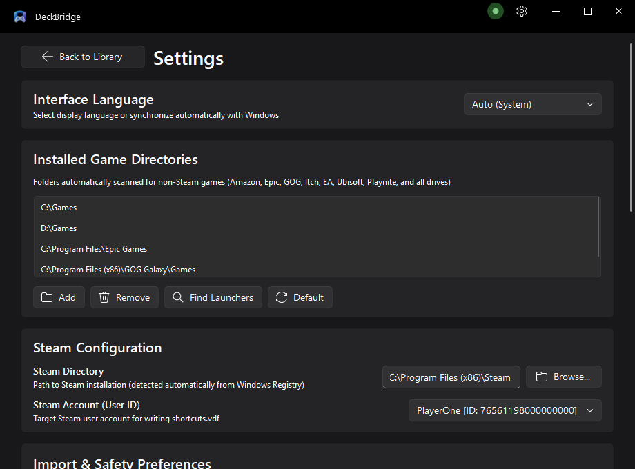

<div align="right">
  <b>English</b> | <a href="README.ru.md">Русский</a>
</div>

<div align="center">

# DeckBridge

**Bridge non-Steam PC games seamlessly into Valve Steam, Big Picture, and Steam Deck with official high-resolution artwork.**

[](https://github.com/msmr14/DeckBridge/releases/latest)
[](https://github.com/msmr14/DeckBridge/actions/workflows/build.yml)
[](https://www.gnu.org/licenses/gpl-3.0)
[](https://www.python.org/downloads/)
[](https://www.microsoft.com/windows)
[](https://github.com/zhiyiYo/PyQt-Fluent-Widgets)
[](https://web.tribute.tg/d/SsO)

</div>

---

## 📥 Download DeckBridge 1.0.0

| Package | Format | Target Platform | Download Link |
| :--- | :--- | :--- | :--- |
| **DeckBridge Linux AppImage** | `.AppImage` (Self-contained) | SteamOS (Steam Deck) & Linux (x64) | [**DeckBridge-x86_64.AppImage**](https://github.com/msmr14/DeckBridge/releases/latest) |
| **DeckBridge Linux Tarball** | `.tar.gz` (Standalone folder) | SteamOS & Linux (x64) | [**DeckBridge-Linux-x64.tar.gz**](https://github.com/msmr14/DeckBridge/releases/latest) |
| **DeckBridge Windows Portable** | `.zip` (Standalone) | Windows 10 & 11 (x64) | [**DeckBridge-v1.0.0-Windows-x64.zip**](https://github.com/msmr14/DeckBridge/releases/download/v1.0.0/DeckBridge-v1.0.0-Windows-x64.zip) |
| **Microsoft Store** | Store App | Windows 10 & 11 (x64) | *Coming soon to Microsoft Store* |

> 💡 **Steam Deck Quick Start:** Download `DeckBridge-x86_64.AppImage` in Desktop Mode, mark it executable (`chmod +x DeckBridge-x86_64.AppImage`), and double-click to run! You can also add it to Steam as a non-Steam game to open it anytime. No Proton or Wine required — it runs 100% natively on SteamOS!

---

## 🎮 Overview

**DeckBridge** is an open-source, local-first utility for Windows 11 and Steam Deck that automatically discovers non-Steam games across all drives and launchers (Epic Games, GOG, Amazon Games, EA App, Ubisoft Connect, Itch.io, standalone directories, and repacks), registers them safely into Valve's Steam shortcuts (`shortcuts.vdf`), and fetches official high-resolution library artwork directly from Valve's official CDN and SteamGridDB.

---

## 📸 Screenshots

<div align="center">

### 🎮 Discover non-Steam games with automatic official Steam artwork


<br/><br/>

### ⚙️ Fluent Design Settings, Safety Controls & Support


</div>

---

## ✨ Key Features

### 🛡️ Bulletproof `shortcuts.vdf` Safety
* **Active Steam Process Guard**: Live process detection via Windows API, `tasklist`, and PowerShell blocks writes while `steam.exe` is running, preventing Steam from overwriting newly added shortcuts on exit.
* **Atomic File Writes**: Modifications are written to temporary files with disk cache flush (`fsync`) before an instantaneous atomic swap (`os.replace`), preventing binary corruption.
* **Automated Backup Hierarchy**: Creates `shortcuts.vdf.bak` and timestamped historical snapshots before any write operation.
* **Integrity Validation**: Verifies VDF binary structure integrity prior to committing changes.

### 🎨 Official CDN Artwork Scraper (Zero API Key Needed)
* **Direct Valve Storefront CDN Access**: Queries Steam Storefront search API to retrieve official 4-piece artwork assets without requiring developer API keys:
  * **Portrait Capsule** (600x900 cover) &rarr; `{grid_id}p.png`
  * **Hero Banner** &rarr; `{grid_id}_hero.png`
  * **Logo with Transparency** &rarr; `{grid_id}_logo.png`
  * **Wide Header** &rarr; `{grid_id}.png`
* **Dual 32-bit & 64-bit Steam ID Compatibility**: Generates both traditional 32-bit Grid IDs and modern 64-bit Steam IDs required by recent Steam client releases (2024+), Big Picture, and Steam Deck.
* **SteamGridDB v2 Integration**: Optional support for custom community artwork via SteamGridDB API key.
* **Interactive Cover Selector**: One-click in-app gallery to review and choose alternative artwork variants.

### 🧠 Intelligent Game & Executable Discovery
* **Junk Filtering**: Filters out setup files, crash reporters, redistributables (`vcredist`, `dxsetup`), anti-cheat engines (`eac`, `battleye`), and helper utilities (`epicwebhelper`, `UnityCrashHandler`).
* **Launcher vs. Shipping Binary Detection**: Detects root game executables with heuristics prioritizing clean directory names and parent root wrappers over subfolder shipping binaries (`Binaries/Win64/*-Shipping.exe`).
* **Clean Naming Engine**: Strips release group tags (`-InsaneRamZes`, `[GOG]`, `[DRM-Free]`, `(Portable)`), version numbers (`v1.0.4`), and build identifiers (`Build 12345`).

### 🪟 Windows 11 Fluent UI
* **Native Acrylic Backdrop**: Hardware-accelerated real-time DWM Acrylic blur backdrop behind the window.
* **Dynamic Accent Synchronization**: Automatically syncs with the Windows 11 system accent color and adapts to Dark/Light themes.
* **Frameless Window Integration**: Custom Fluent title bar with Steam status indicator, refresh controls, and close buttons.
* **Internationalization (i18n)**: Fully localized into 7 languages with on-the-fly switching:
  * English (`en-us`)
  * Русский (`ru-ru`)
  * Deutsch (`de-de`)
  * Français (`fr-fr`)
  * Español (`es-es`)
  * 简体中文 (`zh-hans`)
  * 日本語 (`ja-jp`)

---

## 📁 Project Structure

```
DeckBridge/
├── steam_syncer_gui.py      # Fluent Design GUI application
├── steam_syncer.py          # Standalone CLI core & VDF engine
├── steam_lifecycle.py       # Steam process lifecycle management
├── steam_vdf.py             # Binary shortcuts.vdf parser/writer
├── artwork_scraper.py       # Valve CDN and SteamGridDB scrapers
├── i18n.py                  # Multi-language localization manager
├── scanners/                # Game scanners (Epic, GOG, Standalone)
├── DeckBridge.spec          # PyInstaller packaging specification
├── Package.appxmanifest     # Windows App SDK / MSIX package manifest
├── config.example.json      # Default configuration template
├── PRIVACY.md               # Privacy Policy (MS Store Policy 10.5.1)
├── LICENSE                  # GNU General Public License v3.0
├── test_suite.py            # Backend unit & integration test suite
└── test_gui.py              # Headless GUI automated test suite
```

---

## 🚀 Quick Start

### 1. Requirements
* Windows 10 (1809+) or Windows 11
* Python 3.12+ (if running from source)

### 2. Clone and Install Dependencies
```powershell
# Clone the repository
git clone https://github.com/msmr14/DeckBridge.git
cd DeckBridge

# Create and activate virtual environment
python -m venv .venv
.\.venv\Scripts\Activate.ps1

# Install dependencies
pip install -r requirements.txt
```

### 3. Running DeckBridge

#### Graphical Interface (GUI)
```powershell
python steam_syncer_gui.py
# or double-click run_gui.bat
```

#### Command Line Interface (CLI)
```powershell
python steam_syncer.py "C:\Games" "D:\Games"
# or double-click run_cli.bat
```

**CLI Arguments**:
* `--dry-run`: Scan games and display planned changes without modifying any files.
* `--no-art`: Import shortcuts without downloading artwork.
* `--steam-path "C:\Path\To\Steam"`: Explicit Steam installation path.
* `--user-id "12345678"`: Target specific Steam user account ID.
* `-v`, `--verbose`: Enable detailed debug logging.

---

## 📦 Building from Source & Packaging

### Building Standalone Executable with PyInstaller
```powershell
pyinstaller DeckBridge.spec --noconfirm
```
The compiled standalone build will be located in `dist/DeckBridge/`.

### MSIX Packaging for Microsoft Store
DeckBridge is architected for Microsoft Store and WindowsApps container compliance:
* Configuration is saved in `%LOCALAPPDATA%\DeckBridge\config.json`.
* Cover artwork cache is stored in `%LOCALAPPDATA%\DeckBridge\covers_cache`.
* All 7 UI languages are declared in `<Resources>` within `Package.appxmanifest`.
* No personal user paths or IDs are bundled in the package payload.

---

## 🗺️ Roadmap & Microsoft Store Certification

- [x] Windows 11 Acrylic blur & Fluent Design interface
- [x] Automatic Valve CDN artwork scraping (Capsule, Hero, Logo, Wide)
- [x] Multi-language support (EN, RU, DE, FR, ES, ZH, JA)
- [x] MSIX container compatibility (`%LOCALAPPDATA%` redirection)
- [x] Privacy Policy complying with Microsoft Store Policy 10.5.1
- [x] Automated GitHub Actions CI test & build pipeline
- [ ] Microsoft Partner Center submission and certification
- [ ] Direct Steam Deck Flatpak / Linux client release

---

## 🔒 Privacy & Safety

DeckBridge values your privacy:
* **Zero data collection**: No telemetry, no remote tracking servers, no telemetry beacons.
* Read the complete [Privacy Policy](PRIVACY.md).

---

## ❤️ Support the Developer

If DeckBridge makes managing your PC and Steam Deck game library effortless, you can support ongoing development and maintenance:

### 🧡 Boosty (Bank Cards / Global / RUB)
* **Direct Link:** [boosty.to/n300l/donate](https://boosty.to/n300l/donate)

[-f15f2c?style=for-the-badge&logo=boosty&logoColor=white)](https://boosty.to/n300l/donate)

---

### 💳 Tribute (Bank Cards / Telegram / Stars)
A fast and flexible way to donate via any bank card, Telegram Stars, or cryptocurrency:
* **Web (All bank cards / global):** [web.tribute.tg/d/SsO](https://web.tribute.tg/d/SsO)
* **Telegram Mini App:** [t.me/tribute/app?startapp=dSsO](https://t.me/tribute/app?startapp=dSsO)

[-0088cc?style=for-the-badge&logo=telegram&logoColor=white)](https://web.tribute.tg/d/SsO)

---

### 🪙 Cryptocurrency (USDT, USDC, Litecoin)

| Coin / Token | Network | Deposit Address |
| :--- | :--- | :--- |
| **USDT** | **BNB Smart Chain (BSC / BEP20)** | `0xb9e67030ab0f38d1d88e4eaa605fb2acf0aa0ba3` |
| **USDT** | **TRON (TRC20)** | `TQ4RwzWxs4kD6WXFgJkejRMSeAPsGUTv44` |
| **USDC** | **Solana (SOL)** | `7SjWhmXyAQ2xVxB3BNuxHk1mQW8P5dg3aXVtr1eyT6qF` |
| **Litecoin (LTC)** | **Litecoin Network** | `LRBmSE6GuURdMJzTB971BAz4Z8Z9UXnPbF` |

<br />

<div align="center">
  <table>
    <tr>
      <td align="center"><b>USDT (BEP20)</b><br/></td>
      <td align="center"><b>USDT (TRC20)</b><br/></td>
      <td align="center"><b>USDC (SOL)</b><br/></td>
      <td align="center"><b>Litecoin (LTC)</b><br/></td>
    </tr>
  </table>
  <sub><i>Scan with Bybit, Binance, Trust Wallet, MetaMask, Phantom, OKX, or any Web3 wallet</i></sub>
</div>

---

## 📜 License

DeckBridge is open-source software licensed under the **GNU General Public License v3.0 (GPLv3)**. See [LICENSE](LICENSE) for details.
